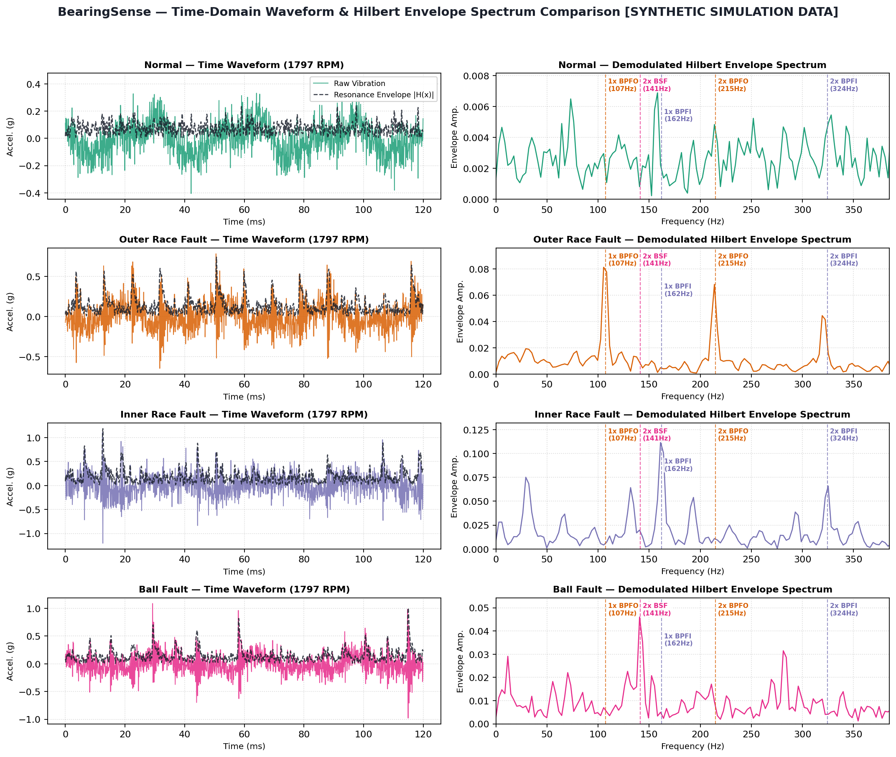
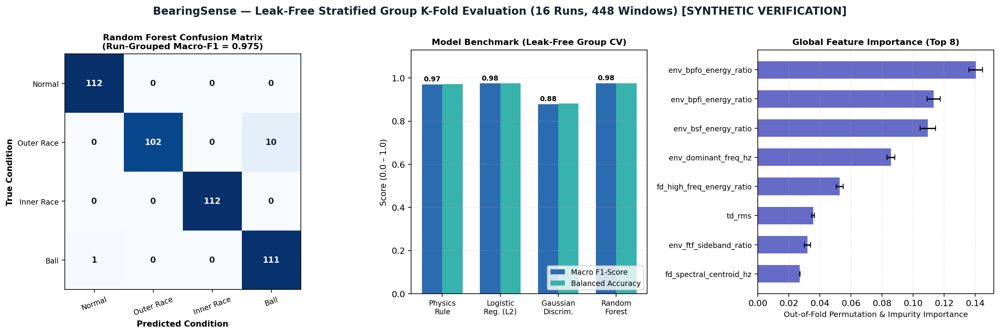
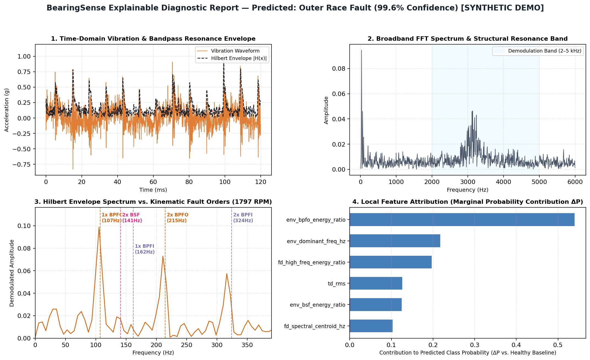

# BearingSense

**Explainable Machine Learning and Hilbert Envelope Spectrum Diagnostics for Industrial Bearing Vibration Signals**

[](https://www.python.org/downloads/)
[](LICENSE)
[](https://github.com/sismax01/BearingSense/actions)

**BearingSense** is an end-to-end Python engineering and machine-learning application for diagnosing rolling-element bearing faults from accelerometer vibration measurements. Engineered by **SISMAX ([`sismax01`](https://github.com/sismax01))** as an educational and research portfolio project bridging **Automatic Control / Digital Signal Processing** and **Explainable Machine Learning (XAI)**, it pairs physical bearing kinematics (characteristic defect orders $\text{BPFO}$, $\text{BPFI}$, $\text{BSF}$, and $\text{FTF}$) with demodulated Hilbert envelope features, leak-free run-grouped cross-validation, and local counterfactual feature attribution.

> **Disclaimer**: BearingSense is an educational and research-oriented software project, not a certified industrial safety or diagnostic instrument.

---

## Key Capabilities & Engineering Highlights

1. **Analytical Bearing Kinematics & Hilbert Envelope Demodulation (`signal_processing.py`, `bearing_kinematics.py`)**:
   - Computes exact analytical fault frequencies for rolling-element bearings, pre-configured for the [Case Western Reserve University (CWRU) Bearing Data Center](https://engineering.case.edu/bearingdatacenter/welcome) **SKF 6205-2RS JEM** (Drive End) and **SKF 6203-2RS JEM** (Fan End) bearings.
   - Isolates high-frequency structural resonances ($2\text{–}5\text{ kHz}$) using zero-phase 4th-order Butterworth bandpass filtering (`scipy.signal.sosfiltfilt`) and extracts the instantaneous amplitude envelope via the Hilbert transform (`scipy.signal.hilbert`).
2. **18 Physics-Informed Features (`features.py`)**:
   - Combines 8 time-domain statistical/impulsiveness indicators (RMS, Peak, Kurtosis, Skewness, Crest Factor, Impulse Factor, Clearance Factor, Shape Factor), 4 broadband frequency-domain descriptors (Spectral Centroid, Spread, Shannon Entropy, Resonance Energy Ratio), and 6 demodulated envelope harmonic ratios ($\text{BPFO}$, $\text{BPFI}$, $\text{BSF}$, $\text{FTF}/\text{sideband}$ ratios, Envelope Kurtosis, and Dominant Envelope Frequency).
3. **Rigorous Leak-Free Evaluation (`evaluation.py`)**:
   - Prevents **window-level data leakage** by grouping all extracted windows by their physical acquisition run (`run_id`) using **Stratified Group K-Fold Cross-Validation**.
   - Includes a built-in controlled experiment comparing leak-free run-grouped splitting against naive random window splitting to demonstrate how random window splits artificially inflate accuracy.
4. **Multi-Model Benchmarking & Three-Tier Explainability (`modeling.py`, `explainability.py`)**:
   - Compares a transparent **Physics-Informed Envelope Rule Baseline**, **L2-Regularized Multinomial Logistic Regression**, **Gaussian Discriminant Classifier**, and a **Random Forest Classifier**.
   - Computes **Out-of-Fold Global Permutation Importance** strictly on held-out validation runs alongside tree Gini impurity reduction.
   - Performs **Full-Recording Multi-Window Aggregation** (`analyze_full_recording`) across all sliding windows of a recording and explains individual diagnoses via counterfactual marginal probability contributions ($\Delta P$ relative to healthy baseline operation) paired with a physical engineering narrative.
5. **Immediate Reproducibility Without Manual Dataset Assembly (`simulation.py`)**:
   - Includes a physics-informed synthetic bearing vibration simulator (`source_type='synthetic_simulation'`) that models damped structural resonance bursts excited at $\text{BPFO}$, $\text{BPFI}$ (with shaft-frequency load-zone modulation), and $2\times\text{BSF}$ (with cage-frequency modulation, intermittent 3D ball spin drop-out, and stochastic slip), allowing full verification out of the box while clearly distinguishing synthetic demonstration outputs from empirical CWRU data.

---

## Visual Overview (Synthetic Verification Pipeline Outputs)

### 1. Time-Domain Waveforms vs. Demodulated Hilbert Envelope Spectra


### 2. Leak-Free Stratified Group K-Fold Evaluation & Out-of-Fold Feature Importance


### 3. Explainable Single-Window Diagnostic Report


---

## Repository Structure

```text
BearingSense/
├── .github/workflows/ci.yml        # GitHub Actions CI (Ubuntu & Windows, Python 3.10–3.12)
├── configs/
│   └── default_config.yaml         # Default bearing geometry, DSP filter, and CV settings
├── data/
│   └── raw/.gitkeep                # Target folder for downloaded CWRU .mat or .csv files
├── docs/
│   ├── dataset_guide.md            # CWRU dataset specifications, catalog IDs, and download guide
│   └── methodology.md              # Mathematical formulation, DSP pipeline, and leakage analysis
├── examples/
│   └── sample_output/              # Pre-generated verification plots, HTML report, and JSON metrics
├── src/
│   └── bearingsense/
│       ├── __init__.py             # Package exports, version, and SISMAX author metadata
│       ├── bearing_kinematics.py   # SKF 6205/6203 geometry and BPFO/BPFI/BSF/FTF equations
│       ├── signal_processing.py    # Butterworth bandpass filtering & Hilbert envelope FFT
│       ├── features.py             # 18 time, frequency, and envelope feature extractors
│       ├── simulation.py           # Physics-informed synthetic bearing vibration simulator
│       ├── data_loader.py          # CWRU .mat (40-file catalog) and .csv ingestion
│       ├── modeling.py             # Physics Rule, Logistic, Gaussian, and Random Forest models
│       ├── evaluation.py           # Stratified Group K-Fold CV & window-leakage comparison
│       ├── explainability.py       # Out-of-fold permutation importance & local attribution
│       ├── visualization.py        # Publication-grade Matplotlib plots & HTML report builder
│       ├── web_app.py              # FastAPI interactive browser workbench
│       └── cli.py                  # Click/Rich command-line interface (`bearingsense`)
├── tests/
│   ├── __init__.py                 # Test package initializer
│   ├── test_kinematics_and_dsp.py  # Unit tests for bearing kinematics and Hilbert envelope DSP
│   ├── test_features_and_loaders.py# Unit tests for 18 features and .mat/.csv loaders
│   ├── test_evaluation_and_cli.py  # Tests for zero group leakage, explainability, and CLI
│   └── test_web_app.py             # Unit tests for FastAPI interactive web workbench routes
├── .gitignore
├── LICENSE                         # MIT License + CWRU third-party data attribution
├── pyproject.toml                  # Standard PEP 621 package configuration
├── requirements.txt                # Runtime dependencies
└── README.md
```

---

## Installation & Quickstart (Windows, Linux, and macOS)

### 1. Clone or Extract the Repository and Create a Virtual Environment

**On Windows (PowerShell):**
```powershell
cd BearingSense
python -m venv .venv
.\.venv\Scripts\Activate.ps1
python -m pip install --upgrade pip
pip install -r requirements.txt
pip install -e .
```

**On Windows (Command Prompt `cmd.exe`):**
```cmd
cd BearingSense
python -m venv .venv
.venv\Scripts\activate.bat
python -m pip install --upgrade pip
pip install -r requirements.txt
pip install -e .
```

**On Linux / macOS:**
```bash
cd BearingSense
python3 -m venv .venv
source .venv/bin/activate
pip install --upgrade pip
pip install -r requirements.txt
pip install -e .
```

---

## Running BearingSense

### 1. Run the Reproducible End-to-End Verification Pipeline (`bearingsense demo`)

You can verify the entire signal processing, leak-free cross-validation, out-of-fold explainability, and reporting workflow immediately without downloading external files:

```powershell
bearingsense demo --output-dir outputs/demo_run --runs-per-class 4 --snr-db 2.0 --seed 42
```

This command generates:
- `outputs/demo_run/diagnostic_report.html` — Self-contained interactive HTML report with embedded plots and tables (open directly in any browser).
- `outputs/demo_run/envelope_diagnostics_grid.png` — 4-class waveform and Hilbert envelope comparison.
- `outputs/demo_run/evaluation_summary.png` — Confusion matrix, model benchmark, and out-of-fold global feature importance.
- `outputs/demo_run/sample_window_explanation.png` — 4-panel local diagnostic explanation.
- `outputs/demo_run/evaluation_metrics.json` — Complete cross-validation metrics and leakage study data.
- `outputs/demo_run/bearingsense_model_synthetic.json` — Serialized Random Forest model bundle.

### 2. Evaluate on Real CWRU `.mat` Files (`bearingsense evaluate`)

1. Download any set of CWRU Drive End `.mat` files (e.g., `97.mat`–`100.mat` for Normal, `105.mat`–`108.mat` for Inner Race, `118.mat`–`121.mat` for Ball, `130.mat`–`133.mat` for Outer Race) from the [CWRU Bearing Data Center](https://engineering.case.edu/bearingdatacenter/12k-drive-end-bearing-fault-data) into `data/raw/`. (See [`docs/dataset_guide.md`](docs/dataset_guide.md) for the complete 40-file catalog.)
2. Run leak-free run-grouped cross-validation (outputs figures, JSON metrics, model bundle, and `diagnostic_report.html`):

```powershell
bearingsense evaluate --data-dir data/raw --output-dir outputs/cwru_eval --folds 4
```

### 3. Diagnose and Explain a Full Recording (`bearingsense analyze`)

To inspect an individual `.mat` or `.csv` file across all sliding windows and generate a 4-panel explainable report:

```powershell
bearingsense analyze --input-file data/raw/130.mat --output-dir outputs/single_analysis
```

### 4. Launch the Interactive Browser Workbench (`bearingsense serve`)

Start the local FastAPI web application to interactively simulate faults across speeds/SNRs or upload `.mat`/`.csv` files in your browser:

```powershell
bearingsense serve --host 127.0.0.1 --port 8000
```
Then open `http://127.0.0.1:8000` in your web browser.

---

## Running Automated Tests

Run the 18-test unit and integration test suite using Python's built-in `unittest` runner (or `pytest`):

```powershell
python -m unittest discover -s tests -p "test_*.py" -v
```

---

## Summary of Synthetic Verification Results

> **Scientific Integrity Note**: The table below reflects verified execution of `bearingsense demo --seed 42` on **synthetic simulation data** (`16` independent physical runs across `4` motor speeds/loads and multiple incipient/severe fault levels, `448` windows total, $\text{SNR} = 2.0\text{ dB}$). These numbers verify software correctness and physical feature separability under noisy multi-run conditions; they are **not** presented as empirical real-world benchmark claims.

| Classifier | Split Strategy | Accuracy | Balanced Acc. | Macro Precision | Macro Recall | Macro F1 (±SD) | Brier Score |
| :--- | :--- | :---: | :---: | :---: | :---: | :---: | :---: |
| **Physics Rule Baseline** | Leak-Free Run-Grouped (4-Fold) | 0.971 | 0.971 | 0.971 | 0.971 | 0.971 (±0.013) | 0.0884 |
| **Logistic Regression (L2)** | Leak-Free Run-Grouped (4-Fold) | 0.975 | 0.975 | 0.977 | 0.975 | 0.975 (±0.046) | 0.0442 |
| **Gaussian Discriminant** | Leak-Free Run-Grouped (4-Fold) | 0.882 | 0.882 | 0.889 | 0.882 | 0.879 (±0.123) | 0.2285 |
| **Random Forest** | Leak-Free Run-Grouped (4-Fold) | 0.975 | 0.975 | 0.977 | 0.975 | 0.975 (±0.039) | 0.0821 |

### Window-Level Data Leakage Demonstration (`evaluation.py`)

When restricting the Random Forest classifier to generic **Time & Broadband Frequency features** (excluding demodulated Hilbert envelope fault-frequency ratios), evaluation strategy makes a dramatic difference:
- **Naive Random Window Split (Leaky)**: Achieves **0.820 Macro-F1** ($81.9\%$ accuracy) because adjacent windows from the same operating run appear in both training and test sets, allowing the model to memorize run-specific speed and noise floors.
- **Leak-Free Run-Grouped Split**: Drops to **0.451 Macro-F1** ($44.9\%$ accuracy) on unseen runs, proving that generic time/FFT statistics alone fail to generalize across operating conditions—whereas adding demodulated **Hilbert Envelope** features (`env_bpfo_energy_ratio`, `env_bpfi_energy_ratio`, `env_bsf_energy_ratio`) restores leak-free cross-run performance to **0.975 Macro-F1**.

---

## License & Attributions

- **Software License**: Released under the [MIT License](LICENSE) by **SISMAX ([`sismax01`](https://github.com/sismax01))**.
- **Benchmark Dataset Attribution**: Experimental bearing geometry and file catalog specifications reference the [Case Western Reserve University (CWRU) Bearing Data Center](https://engineering.case.edu/bearingdatacenter/welcome) (Prof. K. A. Loparo) and the benchmark diagnostic study by W. A. Smith and R. B. Randall (*Mechanical Systems and Signal Processing*, 2015).
